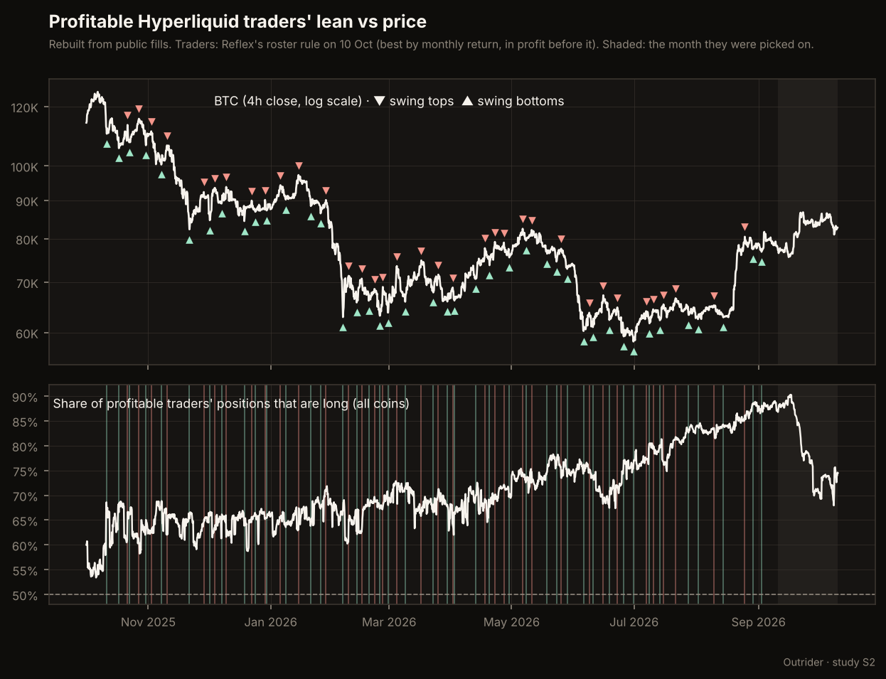

# S2: Does the profitable traders' lean mark tops and bottoms? (declared 10 October 2026, before any data)

The owner's question: the agent now shows the share of profitable Hyperliquid traders' positions that are long.
How does that share relate to price? Earlier studies show these traders are late to trends (they follow spikes,
and keep their longs into tops: Reflex `docs/reviews/traders-vs-spikes-study.md`,
`docs/reviews/traders-turn-at-tops-study.md`). This study looks at the whole picture:
- are they late (their lean follows the past move rather than the next one);
- when they are most short, or most long, does price tend to turn?

Everything below is fixed before any data is pulled. Unless a result clears its bar it is context, not a signal.

## Two data sources

- **Part A: Reflex's live 4-hour record** (`trader_lean`: profitable traders long and short per coin at every 4-hour
  close, kept 400 days, split on `roster_version`). Recorded live, so each reading uses the roster Reflex tracked
  at that moment, with no hindsight. Run when the owner provides an export or a read-only endpoint; Reflex is not
  changed for this without the owner's approval.
- **Part B: a rebuild from Hyperliquid's public records, now.** Like Reflex's tops study:
  - roster: S1's R0 roster (leaderboard, market-maker filter volume / account value > 100, account value at least
    $10,000, top 300 by profit before 10 September), minus the wallets S1 amendment 2 marks bot-like;
  - fills: per wallet, every regular fill Hyperliquid serves since 1 October 2025 (it serves only the 10,000 most
    recent) and the latest 2,000 timed-order (TWAP) slices;
  - coverage: a wallet counts from the later of its two lists' cut-offs (the oldest fill, where a list is full),
    else from 1 October 2025;
  - prices: Hyperliquid 4-hour candles, perpetual coins only (no ':' builder markets, no spot or outcome markets).
  - **Bias, stated now:** the roster is chosen by profit up to 10 September, so before that date these are
    wallets known to have done well. That favours finding the traders right. Part B can therefore give the
    contrarian verdicts below, but "traders are right at extremes" in Part B is reported as consistent with that
    bias, not as a verdict. Only Part A can give it.

## Measures

- **Position** of a wallet on a coin at a 4-hour close t (00, 04, ..., 20 UTC): its position after its last fill on
  that coin before t (rounding below 1e-6 is flat), counted only if the wallet is covered at t.
- **Share long S(t)**: long positions / (long + short positions) over covered wallets.
  - market: all coins together (each wallet-coin position counts once, as in the agent's live pulse);
  - BTC alone; and each coin with at least 10 holders at t.
  - Market bars count only with at least 50 covered wallets and 100 positions.
- **Price**: BTC's 4-hour close, and an equal-weight basket (mean of log returns of every coin with a candle in the
  bar). Returns over the next 1, 3 and 7 days; past returns over 3 and 7 days.
- **Episodes**: the first bar of each run where a condition holds; a new episode needs 3 days since the last one.

## Tests

1. **Late or early (market).** Spearman correlation of the 3-day change in S with the basket's past 3-day return
   (follows) and with its next 3-day return (leads), with a 90% interval from a 7-day block bootstrap.
   "Late to trends" holds if the follow correlation is above 0 with its interval excluding 0, and the lead
   interval includes 0 or sits below it.
2. **Extremes (market).** S's percentile within its own trailing 30 days (no future data). "Most short": bottom
   10%; "most long": top 10%. Next 3-day basket return of the episodes against the median of all bars.
   - **Most short marks local bottoms:** median beats all bars by at least 1 point, at least 55% positive, at
     least 15 episodes.
   - **Most long marks local tops:** median below all bars by at least 1 point, at most 45% positive, at least 15
     episodes.
   - The mirror results ("traders right at extremes") follow the bias rule above.
   - Anything else: context. The same is reported for BTC, description only.
3. **Around tops and bottoms (description only).** Swing tops: a 4-hour close that is the highest within 3 days on
   each side and at least 5% above the lowest close of the 7 days before (BTC: 3%); bottoms mirrored. The median
   path of S from 7 days before to 7 days after. This uses future prices to find the swings, so it describes, it
   does not test.
4. **Coin level.** Coin-bars with at least 10 holders. Most short: S at most 20%; most long: at least 80%. Next
   3-day return minus the basket's. Same bars as test 2, with at least 30 episodes from at least 8 coins.

Wallet concentration (largest wallet's share of positions in each episode set) is reported beside every result.

## Amendment 1 (10 October 2026, during the fill pull, before any result was computed)

Reflex's earlier studies, read after the declaration, cover nearby ground and set the method this study should
follow:
- `traders-vs-spikes-study.md`: profitable traders mostly open after a spike (1.39x their normal rate in the 72
  hours before, about 4x during and after); historical convergences trailed single opens.
- `traders-turn-at-tops-study.md`: they keep their longs when a coin is stretched and add into local tops;
  turning at a top was too rare to test (3 events).
- `position-size-at-tops-study.md`: no clear link between their size and greed, and size did not predict the next
  7 to 14 days (rho about +0.04 to +0.10); BTC was dominated by one entity of three wallets trading together.
None of them tested the market-wide share of longs against the next move, which is what S2 does.

Those studies picked wallets the way Reflex's live roster does, by last month's return, and kept the month the
wallets were picked on out of the headline. That is less biased for history than ranking by profit up to
10 September, and it is the same population the agent's live pulse shows. So Part B changes:
- **Roster (headline):** Reflex's roster version 2 rule on the 10 October leaderboard: market makers out (monthly
  volume over 100 times account value); monthly ROI at least 30% from a month that did not start under $1,000;
  monthly profit at least $10,000; all-time PnL at least this month's PnL; account value at least $5,000; the
  best 600 by monthly ROI. 544 wallets qualify. Bot-like wallets are then removed by S1 amendment 2's rule, applied
  to each wallet's fills from 26 September to 10 October.
- **Headline period:** 4-hour bars up to the data end minus 30 days minus 7 days, so every outcome ends before
  the month the wallets were picked on. Later bars are reported apart as biased.
- **Bias rule unchanged:** the "in profit before this month" condition still favours wallets that did well, so
  "traders right at extremes" stays a non-verdict in Part B.
- **Secondary:** the S1 roster (the original declaration) is run the same way and reported beside it, no verdict.

## Results, part B (run 10 October 2026)

**Short answer.** The share of these traders' positions that are long does not mark tops or bottoms, and it does
not lead the next 3 days. It moves against the recent move: after the market rises they hold fewer longs, after
it falls more. They buy dips and take profit into strength, at the level of the whole group. No result clears its
bar: **context, not a signal**.

### Fixes and deviations (made before the run whose numbers are below)

1. **Fill pull.** The declaration assumed Hyperliquid serves only a wallet's 10,000 most recent fills. It serves
   older ones too, oldest first, so the pull, which stopped at 10,000, left 271 busy wallets' histories ending
   weeks or months early (positions frozen in the past; found by comparing the rebuild with live positions:
   48% of coins on the same side). Each was continued forward to now, up to 40 more pages; 7 could not reach now
   and are left out (1 in the headline roster). Coverage now starts on 1 October 2025 unless the TWAP list is full.
2. **TWAP slices before 1 October 2025** are dropped (they opened positions whose closes fell outside the window).
3. **End check.** A wallet-coin history whose rebuilt position now is on a different side than the wallet's live
   position (read on 10 October) is left out entirely: 168 of 7,586 in the headline roster, 108 in S1's. Causes
   seen: liquidations (closed by the liquidation engine, no fill) and the window edge. After fixes 1 to 3, 86% of
   sampled live positions matched the rebuild; the remainder are mostly trades made after the pull.
4. **Two earlier runs on the flawed data were discarded.** Their numbers were seen; they pointed the same way (no
   lead, lean moving against the past move).

### Data

- Headline roster: 544 wallets; 6 bot-like and 1 incomplete left out; 472 with perpetual fills. Covered from the
  start: 348, rising to 472 at the end. 1,223 positions at the end.
- Headline bars: 1 October 2025 to 3 September 2026 (2,007 to 2,247 bars by test). Average share long: 69.5%.
  The population is long-biased: no coin ever had 20% or fewer of 10+ holders long.

### Test by test (headline: Reflex's roster rule, outcomes ending before the month the wallets were picked on)

| Test | Result | Verdict |
|---|---|---|
| 1. Follows the past 3 days | Spearman -0.16 [-0.27, -0.03] | lean moves **against** the past move |
| 1. Leads the next 3 days | -0.03 [-0.13, +0.09] | no lead |
| 2. Most short (20 episodes), basket 3 days | -0.25%, 50% up (all bars -0.85%) | context |
| 2. Most long (40 episodes), basket 3 days | +0.25%, 52.5% up | context |
| 3. Around 32 market tops / 41 bottoms | share long moves under 1 point from 7 days before to 7 after | no tell |
| 3. Around 35 BTC tops | BTC share long 2.4 points higher 3 days before the top than at it | they trim into BTC strength |
| 4. Coins at 80%+ long (173 episodes, 30 coins), 3 days vs basket | +0.11%, 51% up; no coin ever at 20% or less | context |

"Late to trends" as declared (lean rising after rises) does **not** hold: the lean falls after rises. That fits
Reflex's earlier finding that they open after spikes on a coin: they chase a single coin's move but the group
as a whole takes profit into a market rally and buys a decline.

**BTC (description only).** When they were most short on BTC (26 episodes) BTC fell further: -1.05% at 3 days
(38% up), -4.35% at 7 days (27% up); when most long, +1.05% (60% up) and +0.65% (63% up). This is the "traders
right" pattern the bias rule covers: in part B it is not a verdict; part A (Reflex's live record) can test it.

### Beside the headline (no verdicts)

- **Including the month the wallets were picked on:** the same picture (follow -0.17, lead -0.06; extremes flat).
- **S1's roster** (picked on profit up to 10 September, so known winners for the whole history): lead +0.12
  [+0.03, +0.23], most long +1.44% at 3 days (68% up), most short -1.33%. Exactly the hindsight the bias rule
  warned about: wallets picked for having been right look right in the past. The headline roster, picked on one
  month, does not.

### What this means for the agent

- The share long is a description of the crowd of profitable traders, not a timing tool. The pulse shows it as
  that.
- Its most useful reading is the change against the move: a market rising while the lean falls is these traders
  taking profit, and a market falling while the lean rises is them buying it.
- The only place they look early is BTC, and that cannot be separated from hindsight here. Part A and the
  entity map (E1, separating big money from the crowd) are the next steps.
